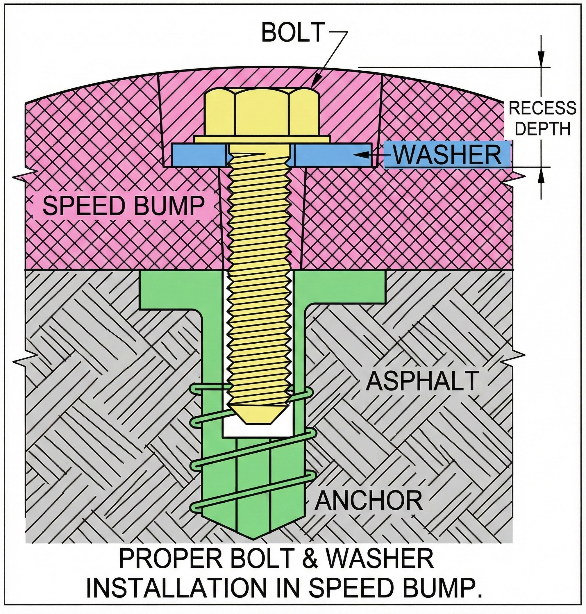

## Summary
* Speed Bumps are one of the top use cases for Asphalt Anchors.
* We recommend the [[SP18]] or [[SP58]] for speed bumps, which experience substantial repeated and sideways forces. Avoid anchors with bolts smaller than 7/16".
* You will need to buy longer bolts at your local hardware store.

## Background
Plastic or rubberized speed bumps and speed humps are some of the more popular applications for our Asphalt Anchors. These devices, sometimes called traffic calming, are installed across a traffic lane to induce drivers to slow down.

Speed humps are a shallow version of speed bumps and have gained popularity over speed bumps as they are less jarring and less damaging to low-slung cars. The devices covered here are installed after the roadway has been completed and are attached to the roadway with anchors. 

Most add-on speed bumps are made from plastic or recycled rubber. Steel bumps are used where heavy truck traffic will wear out other materials too fast. In all cases, these bumps see large forces as the vehicle passes over them. The heavier the vehicle the larger the sideways (shear) forces. Plastic bumps can handle heavier traffic than rubber bumps, but rubber is recommended for residential and light commercial traffic as they are quieter and reduce the forces transmitted to the asphalt by absorbing some.

## Types of Anchor
Asphalt yields to repeated or constant pressure. Anchoring speed bumps to asphalt is thus very different from anchoring to concrete. In concrete a simple expansion anchor applies pressure against the hole walls as the bolt is tightened, and the friction caused by this force will hold the speed bump securely for a long time.

As asphalt yields under expansion pressure, an expansion anchor can lose its grip. Our anchors use adhesive bonding instead. The surrounding pavement still needs to support the forces transmitted by the speed bump.

## Asphalt Anchors
For residential use, we recommend the [[SP18]]. For commercial and heavier traffic, we recommend the [[SP58]]. We have not engineering-tested anchors under speed bump loads. Anchors with bolts smaller than 7/16" are a serious concern under repeated wheel impacts and sideways forces, so we strongly advise against the [[SP10]] and [[SP12]], which use 3/8" bolts. Pull-test results alone do not establish performance under repeated traffic. Consider traffic, pavement condition, and operating temperature when selecting the anchors. See [Understanding Anchor Strength and Guide Loads](/testing/anchor-strength-testing/) or [contact us](https://asphaltanchors.com/pages/contact) for application guidance.

For roads or parking lots exposed to road salt, coastal weather, or corrosive chemicals, see [Zinc Plated vs Stainless Steel Anchors](/product-info/zinc-vs-stainless/) before choosing the anchor material.

## Preparation
Speed bumps are secured to the asphalt by first installing the anchors into the asphalt, then attaching the bumps to the anchors using bolts and washers. Most speed bumps accommodate up to a 3⁄4” diameter bolt and require bolt length of about 3.5”. Speed bumps have several mounting holes that must all line up with the anchors, so mark each location with a template and center punch before drilling. See [Aligning Anchor Holes with a Template and Punch](/installation/hole-alignment/). The hole shown in the picture is a recess for the bolt head. It is essential that the bolt heads stay below the top of the drivable surface to prevent damage to the tires. The diameter of the recess in the speed bump holes must accommodate the head of the bolt plus a socket that will be used to tighten the hex-headed bolts. If the recess available is too small, specify a socket bolt.

## Bolts
Speed bumps require longer bolts than the ones supplied with the anchors, because of the height of the speed bump. Choose a bolt length that threads into the anchor at least one bolt diameter (7/16" for the SP18, 5/8" for the SP58) and no more than 3". There is no strength benefit in going past the minimum engagement, and a bolt that is too long can bottom out in the anchor.

Make sure that you order continuous thread bolts: 
* SP18: Grade 5 7/16"-14
* SP58: Grade 5 5/8”-11

## Thread Lubricant
Due to salt, oils and other chemicals that find their way to the bolts and anchors, you need to protect the thread of the bolts using an anti-seize lubricant. If you use the bolts that are supplied with the anchors, these are already lubricated. If you provide your own bolts, use anti-seize paste so the bolts can be removed in the future. See [Bolts, washers, and anti-seize](/product-info/zinc-vs-stainless/#bolts-washers-and-anti-seize) for which product to use.
